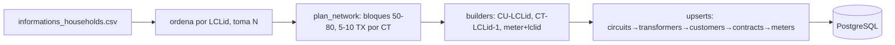

# Presentación lunes — Arquitectura + Costos (30 min)

> Cómo usar: 1 slide por sección. Los bloques `Notas:` son tu guion hablado (no van en el slide). Tiempos sugeridos entre paréntesis.

---

## Slide 1 — Título (1 min)

**VoltiaGrid — Arquitectura end-to-end y costos**
Proyecto 04 · Medición inteligente · 5.500 → 200.000 medidores

Notas: presenta equipo P1–P4 y objetivo de la reunión: alinear arquitectura objetivo, supuestos y dueños de costos. No entres en detalle aún.

---

## Slide 2 — Agenda (1 min)

1. Contexto y números (P4/P1)
2. Data flow end-to-end
3. P1: ingesta, APIs y Seed F4 ✅ (5 min, tu parte)
4. P2: Spark + Data Lake
5. P3: Infra AWS + Costos (framework)
6. P4: Modelo dimensional + Power BI + ADRs
7. Riesgos, decisiones pendientes y próximos pasos

---

## Slide 3 — Contexto de negocio (3 min)

- Reemplazo de medidores convencionales por inteligentes.
- Piloto: 5.500 medidores → 264.000 lecturas/día (48 por medidor).
- Proyección: 200.000 medidores → 9.600.000 lecturas/día (×36).
- Pérdidas no técnicas estimadas: 9%.
- Objetivos: facturar 99% con lecturas reales por franja, identificar 70% de pérdidas a nivel transformador, eventos de demanda con ahorro medido, plataforma costeada para 200k.

Notas: conecta cada objetivo con una parte de la arquitectura (facturación→franjas F7, pérdidas→RN-06 por transformador, demanda→RN-08, costos→P3).

---

## Slide 4 — Data flow end-to-end (3 min)

Pega el diagrama Mermaid de la sección 3 del README (Fuentes → RabbitMQ → S3 raw → Spark → clean/curated → Power BI; RDS ↔ Spark; FastAPI → usuarios; Airflow orquesta).

Notas (lectura izquierda→derecha):
1. Generación: F1/F2/F6 reales, F3/F4/F5/F7 simulados.
2. Ingesta: RabbitMQ persistente + ACK manual; consumidor guarda en crudo, no limpia (reproceso posible).
3. Procesamiento: Spark limpia, deduplica por secuencia (RN-02), estima huecos (RN-03), asigna franjas (RN-05), calcula pérdidas (RN-06) y liquida eventos (RN-09/10).
4. Orquestación: Airflow. 5. Exposición: FastAPI JWT. 6. Analítica: dimensional → Power BI.

---

## Slide 5 — P1: tu parte, Seed F4 US-01 (1 min)

- F4 = verdad operativa: clientes, contratos, medidores, transformadores, circuitos.
- US-01 ✅: seed determinista, modos dev (200) / full (5500), topología 50–80 medidores por TX, upsert idempotente, CLI portable, test CT-06 por hash.
- Resto P1 (próximas USs): simulador F3, productor/consumidor RabbitMQ, API cliente + centro de control, simulador F5.

Notas: deja claro qué está en código hoy vs qué es diseño futuro.

---

## Slide 6 — P1: pipeline del seed (2 min)

Notas: orden de escritura respeta FKs (flush intermedio). Resolvers convierten `circuit_code→circuit_id`, `customer_code→customer_id`, `transformer_code→transformer_id`. Frase clave: "la idempotencia está en la base de datos (`ON CONFLICT`), no en memoria".

---

## Slide 7 — P1: CT-06 en una frase + demo (2 min)

- `python -m seed --mode dev --seed 42 --defect-rate 0` dos veces ⇒ hash MD5 idéntico en las 5 tablas.
- Hash SQL: `md5(string_agg(md5(concat_ws('|', cols)), '' ORDER BY clave_natural))`.
- `pytest tests/test_reproducibility.py -v` → 1 passed. Suite upsert: 7 passed.
- Reglas: RNG aislado `random.Random(seed)`, sin `uuid4/now/created_at`, `dev` = prefijo de `full`.

Notas: si te piden demo en vivo, corre solo el test (1 s) en vez del seed full.

---

## Slide 8 — P2: Spark + Data Lake (5 min, dueño P2)

- Capas S3: raw (tal cual) → clean (validado) → curated (analítica). Parquet + partición por fecha.
- Jobs: normalización :00/:30 (RN-01), deduplicación por secuencia (RN-02), interpolación ≤2h / perfil 4 semanas (RN-03), franjas F7 (RN-05), pérdidas por TX (RN-06), sospechosos (RN-07), eventos (RN-08), incentivos (RN-09/10).
- Pregunta para P2 en la reunión: esquemas raw/clean/curated y particionado.

---

## Slide 9 — P3: Infra AWS (5 min, dueño P3)

- VPC (subnets, SGs, endpoints S3/ECR), ALB + ECS Fargate (API), Spark en Fargate (Spot para histórico), 1 componente en EKS (exigencia programa), RDS PostgreSQL, S3, RabbitMQ (EC2/ECS vs Amazon MQ), Airflow (MWAA vs propio), CloudWatch/X-Ray, CI/CD + secret scanning.
- Pregunta para P3: MWAA vs propio, Multi-AZ sí/no, Terraform/CF.

---

## Slide 10 — Costos: framework, no cifras (5 min, dueños P3/P4)

| Categoría | Driver | Optimización |
|---|---|---|
| Compute API/datos | vCPU/h, duración jobs (<45 min cierre) | Fargate Spot en histórico |
| Orquestación | entorno/h + workers | MWAA vs propio |
| Mensajería | instancia/h, throughput 264k→9.6M/día | colas separadas vivo/reenvío |
| RDS | instancia/h, GB, IOPS, Multi-AZ | Reserved Instances, réplicas lectura |
| S3 3 años | GB/mes por clase | Standard→IA→Glacier + Parquet |
| Red | hora + GB transfer | VPC Endpoints, multi-AZ sí/no |
| Observabilidad/CI | ingestión, minutos | retención acotada |

Riesgos: Data Transfer, RDS sin/costos Multi-AZ, cuello RabbitMQ en reenvíos (48k de golpe), retención sin lifecycle.
Checklist de salida: supuestos firmados, elecciones (MWAA/MQ/Multi-AZ), tagging, dueño del cost model + fecha con números de calculadora AWS.

---

## Slide 11 — P4: dimensional + Power BI + ADRs (5 min, dueño P4)

- Hechos: consumo, pérdidas, eventos. Dimensiones: cliente, medidor, transformador, tiempo, franja, clima.
- 6 preguntas de negocio con query de control que cuadra con el tablero.
- ADRs formales en `voltiagrid-docs`; runbooks.

---

## Slide 12 — Trazabilidad US-01 (1 min)

| AC | Test | Código |
|---|---|---|
| AC1 reproducibilidad | `test_seed_reproducibility` (hash 5 tablas) | `seed/upsert.py`, RNG aislado |
| AC2 volúmenes | conteos dev/full | `seed/config.py` |
| AC3 coherencia | rango 50–80, FK íntegras | `seed/network.py`, `seed/f1.py` |
| AC4 portabilidad | misma `DATABASE_URL` | `.env.example`, CLI |

---

## Slide 13 — Riesgos y decisiones pendientes (2 min)

- Reenvíos masivos (CA-08) sin atrasar tráfico vivo → colas separadas + escalado temporal (P1+P3).
- Relojes desincronizados → RN-01 (P2).
- Estimados >10% ⇒ no facturar + inspección (RN-04, P2+negocio).
- Pendientes: repo `voltiagrid-infra` (propuesta), IaC Terraform vs CF, detector de secretos, componente EKS, herramienta observabilidad.

---

## Slide 14 — Próximos pasos + Q&A (2 min)

- P1: F3, RabbitMQ prod/cons, APIs, F5.
- P2: jobs Spark + esquemas lake.
- P3: Terraform, MWAA, cost model con números.
- P4: dimensional, PBIX, ADRs formales.
- Q&A: deja 5 min.

---

## Anexo — frases técnicas de respaldo

- "La idempotencia está en la base de datos (`ON CONFLICT`), no en memoria."
- "El determinismo está en tres capas: generación, escritura y verificación."
- "`dev` es prefijo ordenado de `full`."
- "El consumidor no limpia (RN-02 se resuelve en Spark) para no perder crudo."
- "Sin `created_at`/`uuid4` el hash es estable entre corridas."
