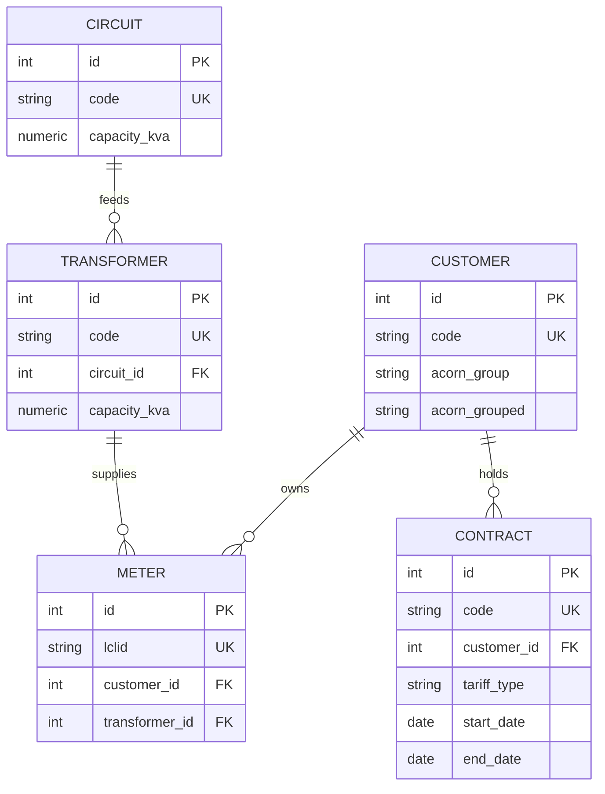

# Network inventory ERD (F4)

Entity-relationship diagram of the inventory database filled by the seed (US-01, KAN-9). Task T-01.1 (KAN-10).

## Diagram

## Tables

| Table | What it is for | Natural key (used by the upsert) |
|---|---|---|
| `circuit` | Electrical circuit with its capacity. RN-08 compares the projected load against 85% of this capacity. | `code` |
| `transformer` | Transformer that belongs to a circuit and has its own capacity. RN-06 computes losses per transformer and the control center reads its load. | `code` |
| `customer` | Customer (household) with its ACORN socio-economic group, used by the dashboard to analyse consumption. | `code` (derived from `LCLid`) |
| `contract` | Customer contract with its tariff type and validity dates. RN-07 needs to know whether the contract changed. | `code` |
| `meter` | Smart meter, identified by the F1 `LCLid`, connected to one transformer and one customer. | `lclid` |

## Relationships

- A circuit feeds many transformers (`circuit` 1 → N `transformer`).
- A transformer supplies many meters (`transformer` 1 → N `meter`). US-01 rule (AC3): between 50 and 80 meters per transformer.
- A customer owns one or more meters (`customer` 1 → N `meter`). The pilot has one meter per customer, but the model does not limit it.
- A customer has one or more contracts over time (`customer` 1 → N `contract`).

## Key fields

| Field | Type | Note |
|---|---|---|
| `capacity_kva` | `NUMERIC(8,2)` | Capacity in kVA, in `circuit` and `transformer`. |
| `lclid` | `VARCHAR(20)` | F1 identifier (for example `MAC000002`). |
| `acorn_group` | `VARCHAR(30)` | ACORN group as it comes in F1. |
| `acorn_grouped` | `VARCHAR(20)` | `Affluent`, `Comfortable`, `Adversity` or `Unknown` (CHECK constraint). |
| `tariff_type` | `VARCHAR(20)` | `standard` or `dynamic` (standard or time-of-use tariff in F1). |
| `start_date`, `end_date` | `DATE` | `end_date` stays empty while the contract is active. |

## Design decisions

- **Surrogate `id` plus a unique natural key.** Every table has an internal `id`, but the seed identifies each row by its natural key (`code` or `lclid`). That key is what makes the idempotent upsert of T-01.5 possible (`INSERT ... ON CONFLICT`).
- **Deterministic natural keys.** They follow a fixed rule (`CT-000`, `TR-00000`, `CU-<LCLid>`), with no random numbers or current dates, so the same seed always produces the same data (AC1).
- **No creation timestamps.** Columns such as `created_at` with a default value are not added: they would change on every run and break the hash test of T-01.7.
- **Capacity on circuit and transformer.** Required by T-01.1 and used by RN-06 and RN-08.
- **ACORN on `customer`, tariff on `contract`.** The ACORN group describes the household. The tariff type is a contract condition that can change over time, and RN-07 depends on it.
- **The 50 to 80 meters per transformer range is not a database constraint.** The seed generation (T-01.4) guarantees it and an automated test checks it; a constraint of that kind would complicate the load.

## Outside this ERD

- **Meter readings** (F3, F1) are not in this database: they live in the data lake (S3) and Spark processes them.
- **Tariff bands (F7)** are a separate CSV.
- **Concentrators** do not appear because F4 does not include them. The F3 simulator derives one concentrator per transformer (`DC-<transformer code>`).

## Traceability

F4, E-03, CT-06. Supports AC1 to AC4 of US-01 and rules RN-06, RN-07 and RN-08.
